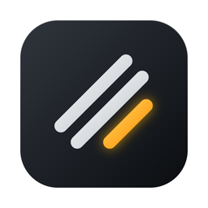
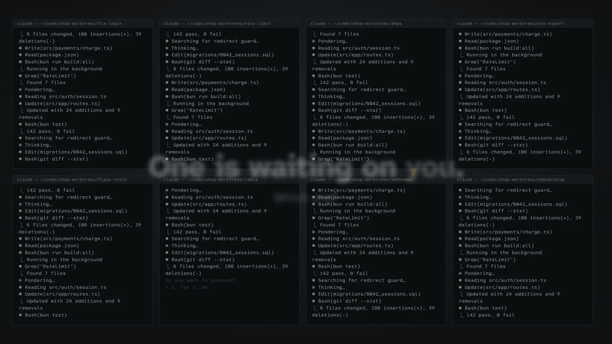
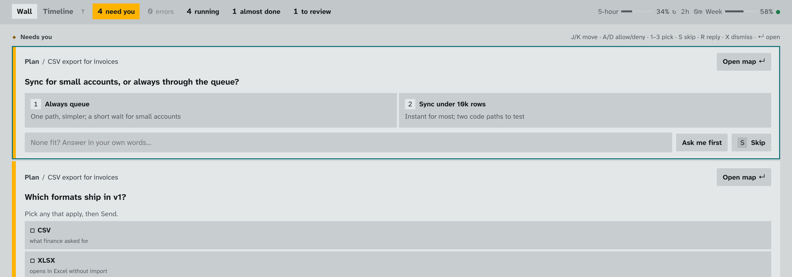
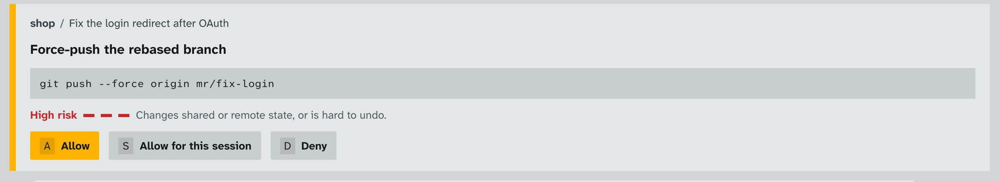
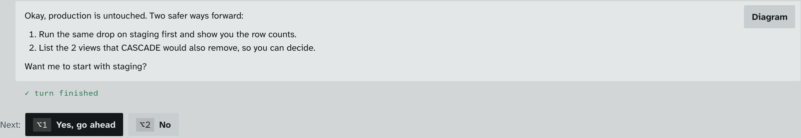
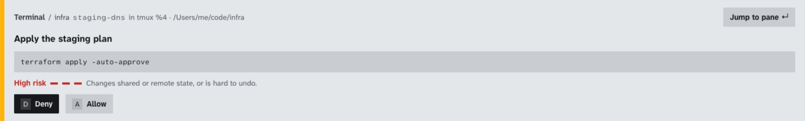
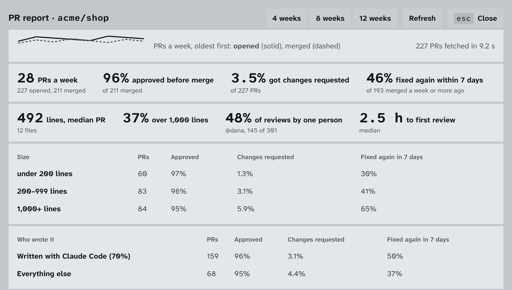
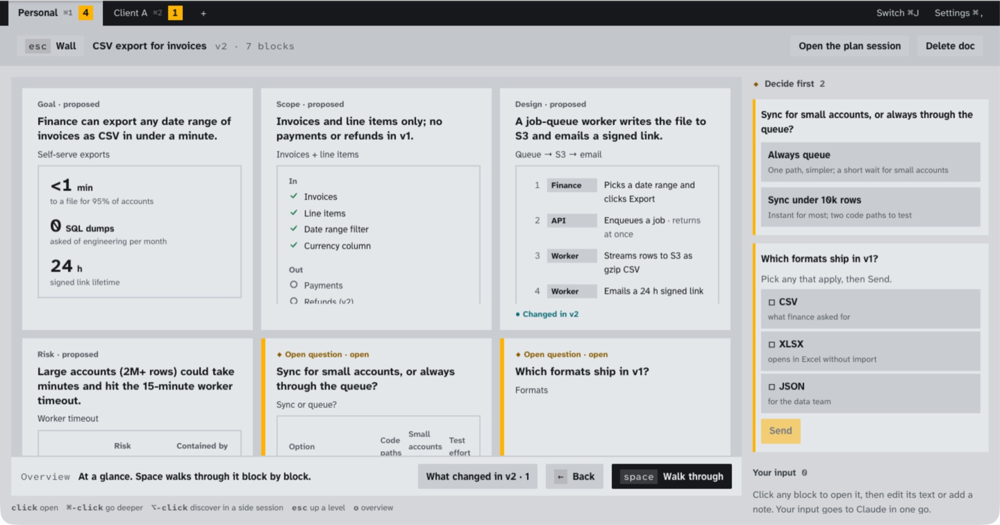
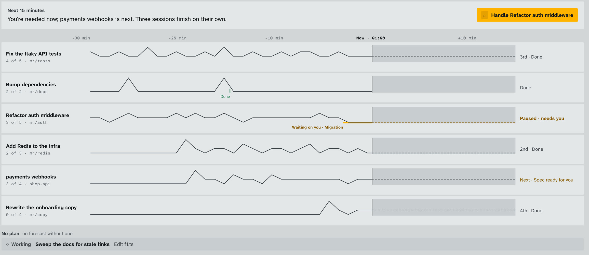
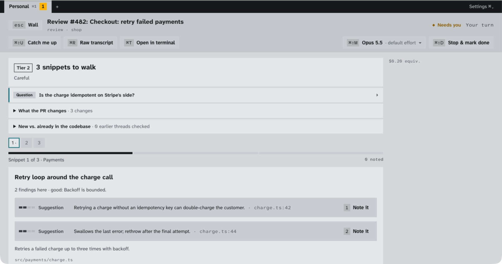

<p align="center">
  
</p>

<h1 align="center">Cockpit</h1>

<p align="center">
  <b>Run more Claude Code sessions without losing track.</b><br>
  Cockpit runs your sessions side by side and pulls everything that needs you into one queue, with the exact command or question in front of you. One key each, and every session keeps moving.
</p>

<p align="center">
  <a href="https://github.com/getcockpit/cockpit/releases/latest"><b>⬇ Download for free</b></a> &nbsp;·&nbsp;
  <a href="https://getcockpit.github.io/#film">▶ Watch the 45-second film</a> &nbsp;·&nbsp;
  <a href="https://getcockpit.github.io/">Website</a>
</p>

<p align="center">
  
  
  
</p>

<p align="center">
  <a href="https://getcockpit.github.io/#film"></a>
</p>

## Claude Code is fast. You're the bottleneck.

Run a few Claude Code sessions side by side and your day turns into babysitting:

- **Which tab is waiting on me?** A session sits idle for twenty minutes because its "Allow?" scrolled out of view.
- **What did it just change?** The risky edit looks exactly like the harmless one.
- **Where was I?** Every switch back costs minutes of rereading.

Cockpit takes that work off your plate. It shows each decision with **only the context it needs**: the question and its trade-offs, the exact command and its risk, what changed. You stop reading and just decide, and you finish the day less drained.

In its author's first four days: **10× more Claude Code sessions a day** (6.9 → 71.5) and **3× more running at once** (3.8 → 11 at peak). It's a small sample, and most of that week went into building Cockpit with Cockpit.

## What you get

**⚡ One queue for everything that needs you.**
Permissions, questions and plan approvals from every session land in a single list. Answer each with one key: **A** to allow, **D** to deny, **1–3** to pick an option. Nothing waits on you without you knowing.

**🖥 Keep your terminal.** *New*
Already run Claude Code in tmux, iTerm or a plain terminal? Turn on **Terminal sessions** in Settings once, and every permission prompt from those sessions also lands in the queue, with the exact command, folder, repo and branch. Answer it in Cockpit or in the terminal, whichever comes first. With Cockpit closed, the terminal asks as it always has, and nothing is ever allowed without you. macOS and Linux; not on Windows yet.

**📊 Know what your agents' PRs are doing.** *New*
The PR report shows, for one repo: PRs a week, PR size, how many were approved, how many got changes requested, how many needed a fix to the same files within a week, and who carries the review load, split by PRs written with Claude Code and the rest. It reads GitHub on your machine through `gh`, with no Claude usage. Copy it as Markdown or an image, with names left out. Open it from **⌘K → Review**.

**🧭 Ten sessions, zero collisions.**
Every session works in its own copy of your repo, so they never trip over each other. Start a new one in a second with **⌘K**.

**🚦 See the risk before it runs.**
A production `DROP TABLE` or a force-push stops in red, with the exact command, before anything happens. Every change is mapped by folder, so you can see what moved at a glance.

**🗺 Plans you can actually read.**
Ask Claude to plan before it codes, and you get a clear one-page map (goal, scope, design, risks, open questions) instead of chat scrollback. Mark it up, send all your notes at once, then hit **Build from doc**.

**⏱ Know what's coming.**
The timeline shows what each session did, what's next, and which one will need you in the next 15 minutes, so you always know where to look.

**🔍 Code review without the wall of diff.**
Pull requests are walked snippet by snippet, riskiest first. Note a finding with one key and it becomes a review comment.

**📱 Answer from your phone.**
Pair your iPhone once with a QR code; every prompt reaches it as a notification, and Face ID allows it. End-to-end encrypted through a public relay that can't read it, with no Cockpit account. Your computer has to be awake.

**🤖 Reviews that start themselves.**
Turn on auto-review, and a PR that asks for your review gets your `/review` by itself, in its own copy of the repo, waiting as findings. Nothing is posted until you publish.

**🔓 Never locked in.**
The full transcript is one key away, and any session can move to a real terminal whenever you want.

## See it

**Everything that needs you, in one queue.** Press a number to answer, A to allow, D to deny.



**Catch the command that sounds harmless.** "Drop the old invoices table" turns out to be production, with `CASCADE`. Press D, and Claude comes back with a safer plan.




**Prompts from your terminal sessions, in the same queue.** Answer here or in the pane; Jump to pane brings the terminal forward.



**The PR report**, shown on an example repo. For one real five-person team over eight weeks it read: 96% approved, 3.5% ever got changes requested, and 46% needed a fix to the same files within a week (65% for PRs over 1,000 lines).



**Plans you can read in ten seconds.** Goal, scope, design, risks and open questions on one page.



**Which session needs you next.** What ran, what's next, and who's waiting.



**Code review, one finding at a time.** Note a finding with one key and it becomes a review comment.



## Private by design

- **Your own Claude.** Cockpit drives the Claude Code you already use, on the plan you already pay for. There's no extra subscription.
- **Your data stays home.** Everything is stored on your computer. There's no Cockpit server and no account to create.
- **No tokens touched.** Cockpit never sees or stores your Claude login.
- **Open source.** MIT licensed. Read every line.

## Get started (about 2 minutes)

1. **Install Claude Code** and sign in once, if you haven't yet: [claude.ai/code](https://claude.ai/code).
2. **Install Cockpit.** One line, with no security prompts. On macOS or Linux, in Terminal:

   ```bash
   curl -fsSL https://getcockpit.github.io/install.sh | bash
   ```

   On Windows, in PowerShell:

   ```powershell
   irm https://getcockpit.github.io/install.ps1 | iex
   ```

   Or download it from [Releases](https://github.com/getcockpit/cockpit/releases/latest): `.dmg` for macOS 11+, `-setup.exe` or `.msi` for Windows 10/11, `.AppImage`, `.deb` or `.rpm` for Linux.
3. **Open it**, pick a project folder, and start your first session.

Installing from the `.dmg` by hand? The app isn't notarized yet, so run `xattr -dr com.apple.quarantine /Applications/Cockpit.app` once. On Windows, choose **More info → Run anyway** if SmartScreen asks. Step-by-step help: [Install guide](docs/INSTALL.md).

> macOS is the most polished today. Linux and Windows are brand new, and push-to-talk voice is macOS-only for now. Found something odd? [Open an issue](https://github.com/getcockpit/cockpit/issues).

## FAQ

**Is it free?** Yes, completely. Your sessions use your existing Claude plan, just as they do in the terminal.

**Do my skills, commands, hooks and settings still work?** Yes. It's your real Claude Code with your real setup.

**How does Terminal sessions work, and what does it change?** It adds one hook to Claude Code's user settings (`~/.claude/settings.json`). When a terminal session asks for permission, the hook passes that request (the tool, the command, the folder) to Cockpit on your machine and waits; your terminal shows its prompt at the same time. It sees nothing else, apart from the session's log to notice when you've answered in the terminal. Turn it off and the file goes back exactly as it was.

**Will more sessions use up my Claude plan faster?** Yes: every session uses your plan, exactly as in a terminal. Cockpit shows your 5-hour and weekly usage with when they reset, and you choose how many sessions may work at once.

**Is this made by Anthropic?** No. Cockpit is an independent open-source project built on Anthropic's official Agent SDK. "Claude" and "Claude Code" are trademarks of Anthropic.

**Can I contribute?** Please do. Developer docs are in [AGENTS.md](AGENTS.md) and [docs/DEVELOPMENT.md](docs/DEVELOPMENT.md).

---

<p align="center">
  If Cockpit saves you time, <b>⭐ star the repo</b>. It helps other people find it.<br>
  <sub>MIT © Bohdan Kostko · built with Claude Code, mostly from inside Cockpit</sub>
</p>
