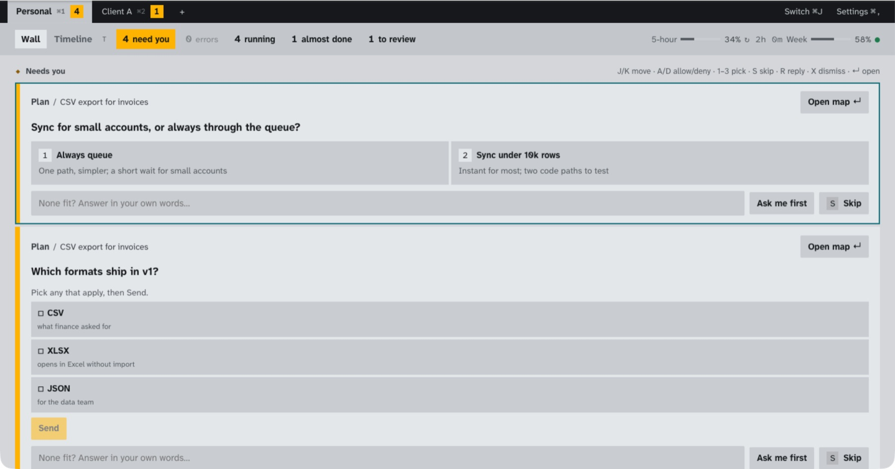
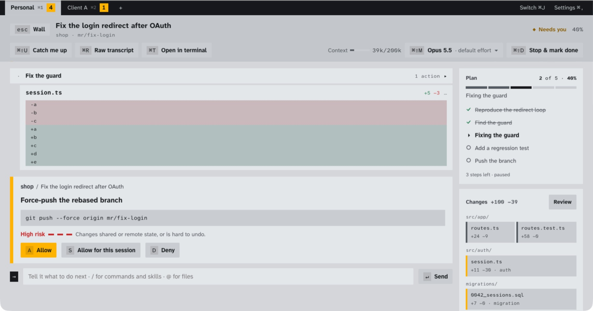

<p align="center">
  
</p>

<h1 align="center">Cockpit</h1>

<p align="center">
  <b>Run ten Claude Code sessions at once, and steer them by glancing instead of reading.</b><br>
  A desktop front-end for Claude Code that turns terminal text into decision cards, plans, change maps and a timeline.
</p>

<p align="center">
  <a href="https://github.com/kostkobv/cockpit/releases/latest"><b>Download</b></a> ·
  <a href="https://kostkobv.github.io/cockpit/">Website</a> ·
  <a href="https://kostkobv.github.io/cockpit/#demo">Watch the 40-second demo</a> ·
  <a href="docs/INSTALL.md">Install guide</a>
</p>

<p align="center">
  <a href="https://github.com/kostkobv/cockpit/actions/workflows/ci.yml"></a>
  
  
</p>

<p align="center">
  <a href="https://kostkobv.github.io/cockpit/#demo"></a>
</p>

---

## Why it's amazing

Claude Code is great at doing the work. Most of your time with it goes into **waiting, scrolling and context-switching**: Which tab asked me something? What did it change? Is it stuck, or done? Cockpit fixes that part.

- **Ten sessions, one queue.** Every session gets its own git worktree, so they never step on each other. Anything that needs you (a permission, a question, a plan to approve) lands in one **Needs you** queue. Answer with one key: `A` allow, `D` deny, `1–3` pick.
- **Visuals instead of scrollback.** A question becomes a card with its options. A plan becomes a progress panel. Edits become a **change map** grouped by folder and flagged by risk. A force-push shows up in red with the exact command, before anything runs.
- **See the next 15 minutes.** The **Timeline** shows what each session did, what's next, and which one will need you, so you know where to look.
- **Plan in documents, not chat.** Plan sessions write a **working doc**: goal, scope, design, risks, open questions. Each block gets its own visual. Walk it block by block, annotate anything, and send all your notes back in one go, like a PR review. Then **Build from doc**.
- **PR review that respects your attention.** Your `/review` command becomes a guided walk through the risky snippets. Note each finding with one key, and your notes become the PR comments. Address mode does the reverse: each reviewer thread becomes a card with fix options, then the proof and the reply.
- **Your Claude, your machine.** Cockpit drives *your* `claude` through Anthropic's official Agent SDK, on *your* subscription. It never reads or stores your tokens. Everything is kept in a local, append-only SQLite log, and there is no server.
- **Never trapped.** The raw transcript is one key away (`⌘R`), and `⌘T` hands any session to a real terminal.
- **Workspaces.** Separate Claude memory and history per client or project, with your own skills, commands and settings shared across all of them.
- **It fixes itself.** In god mode you point at anything that looks wrong, and Cockpit starts a Claude Code session on its own source to fix it, rebuilds, and relaunches, with a health check and automatic fallback.

## Screens

| | |
|:--|:--|
|  **Focus:** the plan, the change map, and the exact command waiting on you. |  **Working docs:** a plan you can see at a glance, with open questions pinned to the side. |
|  **Timeline:** what ran, what's next, who will need you. |  **Review:** walk a PR snippet by snippet and note findings with one key. |

## Install

Download from [**Releases**](https://github.com/kostkobv/cockpit/releases/latest):

| Platform | File | Notes |
|:--|:--|:--|
| **macOS 11+** (Apple Silicon + Intel) | `Cockpit-<version>.dmg` | Not notarized yet: run `xattr -dr com.apple.quarantine /Applications/Cockpit.app` once |
| **Linux** (x64) | `.AppImage`, `.deb`, `.rpm` | Needs WebKitGTK 4.1 (Ubuntu 22.04+, Fedora 38+) |
| **Windows 10/11** (x64) | `.msi` or `-setup.exe` | SmartScreen may warn on first run: **More info → Run anyway** |

**You also need** Claude Code, installed and signed in:

```bash
curl -fsSL https://claude.ai/install.sh | bash   # macOS / Linux
claude                                           # sign in once
```

On Windows, see [Claude Code setup](https://docs.anthropic.com/en/docs/claude-code/setup). Full guide: [docs/INSTALL.md](docs/INSTALL.md).

> **Platform status:** macOS is the daily driver. Linux and Windows builds are new: sessions, the wall, docs, review and the timeline work there. Push-to-talk is macOS-only, and Windows runs commands through `cmd` instead of your login shell. Bug reports are very welcome.

## How it works

```
React UI (ui/) ──Tauri IPC──▶ Rust core (src-tauri/) ──NDJSON stdio──▶ sidecar (Bun + Agent SDK) ──▶ your `claude`
                                   │                                         ▲
                                   └── SQLite event log ◀── every message ───┘
```

- **Sidecar.** The only code that talks to Claude Code, through the official [Agent SDK](https://docs.anthropic.com/en/docs/claude-code/sdk), signed in as you.
- **Event log.** Every agent message and user action is appended to SQLite before the UI sees it. The UI state is a replay of that log, so a crash or relaunch loses nothing.
- **Picker.** Maps each moment (a permission, a question, a todo list, a diff) to a component from a fixed catalog in under 16 ms. No model call is needed to draw a card.
- **Optional Cockpit layer.** With your own Anthropic API key it also draws richer views and titles after each turn, with its cost metered. Everything else works without it.

## Build from source

Needs Rust, Bun, and on Linux the [Tauri prerequisites](https://v2.tauri.app/start/prerequisites/).

```bash
./scripts/dev.sh                  # bootstrap + run with hot reload
./scripts/package.sh              # macOS: dist/Cockpit-<version>.dmg (universal)
(cd ui && bunx vite --port 1530)  # UI demo without Claude: http://localhost:1530/?demo=busy
```

Tests: `(cd ui && bun run test)`, `(cd sidecar && bun test)`, `(cd src-tauri && cargo test)`. More in [docs/DEVELOPMENT.md](docs/DEVELOPMENT.md) and [CLAUDE.md](CLAUDE.md).

## Status

Cockpit is built with Claude Code, mostly from inside Cockpit. Its bar for v1 is seven days of real work without opening Claude Code in a terminal. The product thinking is in the open: [PRD](docs/PRD.md), [design plan](docs/DESIGN.md), [jobs to be done](docs/JTBD.md), [decision log](docs/DECISIONS.md).

Not affiliated with Anthropic. "Claude" and "Claude Code" are Anthropic's trademarks.

## License

[MIT](LICENSE) © Bohdan Kostko
