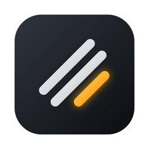
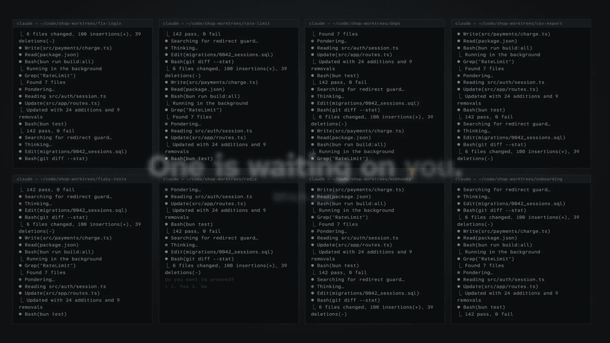
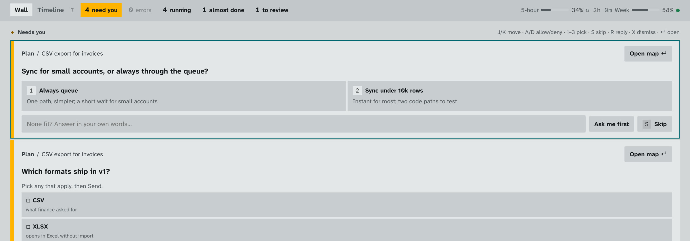
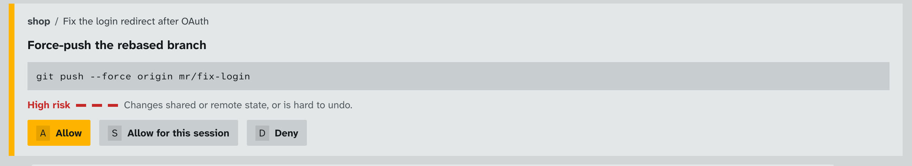
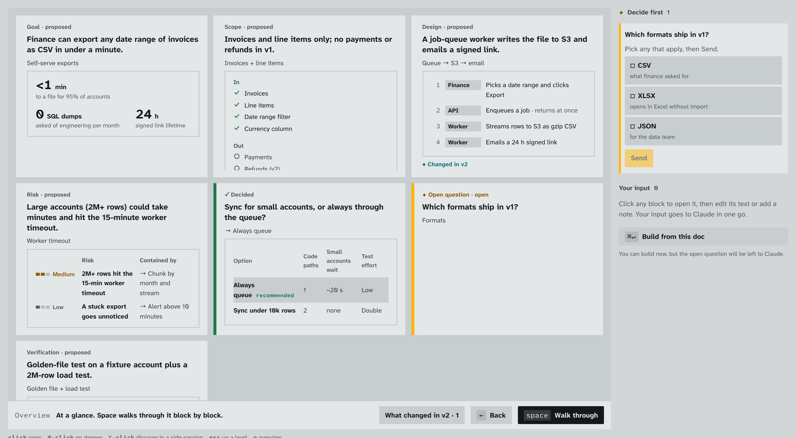
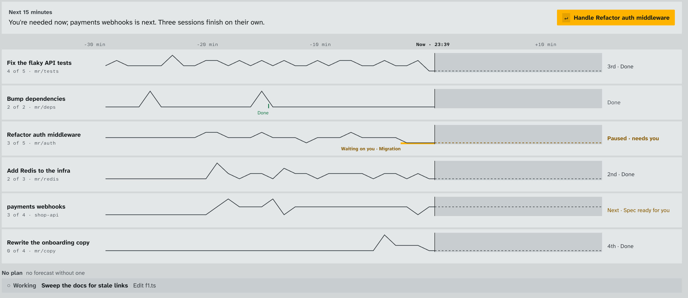
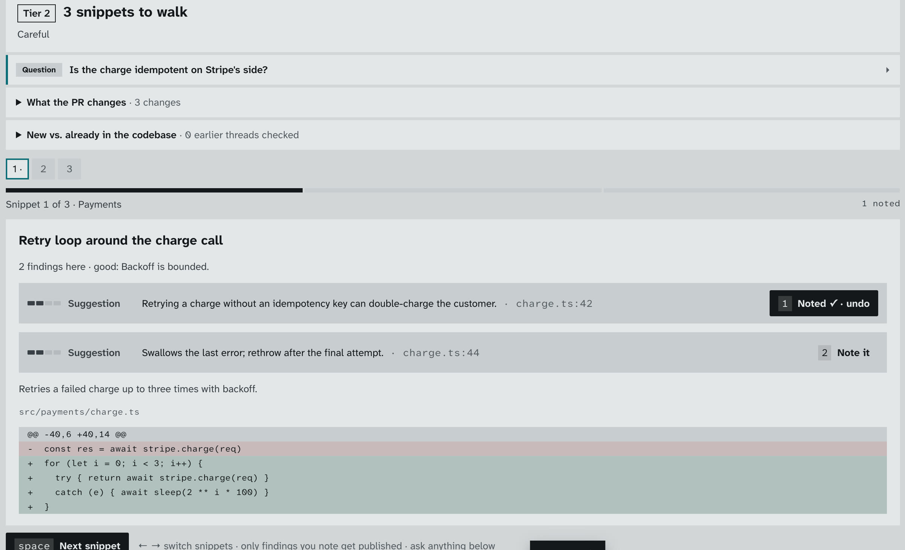

  

<h1 align="center">Cockpit</h1>

  <b>Run ten Claude Code sessions. Read none of them.</b> 
  Cockpit turns Claude Code's wall of terminal text into cards you answer with one key, so you can run many sessions at once and stay in control.

  <a href="https://github.com/kostkobv/cockpit/releases/latest"><b>⬇ Download for free</b></a> &nbsp;·&nbsp;
  <a href="https://kostkobv.github.io/cockpit/#film">▶ Watch the 40-second demo</a> &nbsp;·&nbsp;
  <a href="https://kostkobv.github.io/cockpit/">Website</a>

  
  
  

  

## Claude Code is fast. You're the bottleneck.

Run a few Claude Code sessions side by side and your day turns into babysitting:

- **Which tab is waiting on me?** A session sits idle for twenty minutes because its "Allow?" scrolled out of view.
- **What did it just change?** The risky edit looks exactly like the harmless one.
- **Where was I?** Every switch back costs minutes of rereading.

Cockpit takes that work off your plate.

## What you get

**⚡ One queue for everything that needs you.**
Permissions, questions and plan approvals from every session land in a single list. Answer each with one key: **A** to allow, **D** to deny, **1–3** to pick an option. Nothing waits on you without you knowing.

**🧭 Ten sessions, zero collisions.**
Every session works in its own copy of your repo, so they never trip over each other. Start a new one in a second with **⌘K**.

**🚦 See the risk before it runs.**
A force-push or a database migration shows up in red, with the exact command, before anything happens. Every change is mapped by folder, so you can see what moved at a glance.

**🗺 Plans you can actually read.**
Ask Claude to plan before it codes, and you get a clear one-page map (goal, scope, design, risks, open questions) instead of chat scrollback. Mark it up, send all your notes at once, then hit **Build from doc**.

**⏱ Know what's coming.**
The timeline shows what each session did, what's next, and which one will need you in the next 15 minutes, so you always know where to look.

**🔍 Code review without the wall of diff.**
Pull requests are walked snippet by snippet, riskiest first. Note a finding with one key and it becomes a review comment.

**🔓 Never locked in.**
The full transcript is one key away, and any session can move to a real terminal whenever you want.

## See it

**Everything that needs you, in one queue.** Press a number to answer, A to allow, D to deny.

**The risk, before it runs.** You see the exact command and how much it could hurt.

**Plans you can read in ten seconds.** Goal, scope, design, risks and open questions on one page.

**Which session needs you next.** What ran, what's next, and who's waiting.

**Code review, one finding at a time.** Note a finding with one key and it becomes a review comment.

## Private by design

- **Your own Claude.** Cockpit drives the Claude Code you already use, on the plan you already pay for. There's no extra subscription.
- **Your data stays home.** Everything is stored on your computer. There's no Cockpit server and no account to create.
- **No tokens touched.** Cockpit never sees or stores your Claude login.
- **Open source.** MIT licensed. Read every line.

## Get started (about 2 minutes)

1. **Install Claude Code** and sign in once, if you haven't yet: [claude.ai/code](https://claude.ai/code).
2. **Download Cockpit** for your system from [Releases](https://github.com/kostkobv/cockpit/releases/latest):

   | System | Download |
   |:--|:--|
   | **macOS 11+** (Apple Silicon and Intel) | `.dmg` |
   | **Windows 10/11** | `-setup.exe` or `.msi` |
   | **Linux** | `.AppImage`, `.deb` or `.rpm` |

3. **Open it**, pick a project folder, and start your first session.

First time on macOS? The app isn't notarized yet, so run `xattr -dr com.apple.quarantine /Applications/Cockpit.app` once. On Windows, choose **More info → Run anyway** if SmartScreen asks. Step-by-step help: [Install guide](docs/INSTALL.md).

> macOS is the most polished today. Linux and Windows are brand new, and push-to-talk voice is macOS-only for now. Found something odd? [Open an issue](https://github.com/kostkobv/cockpit/issues).

## FAQ

**Is it free?** Yes, completely. Your sessions use your existing Claude plan, just as they do in the terminal.

**Do my skills, commands, hooks and settings still work?** Yes. It's your real Claude Code with your real setup.

**Is this made by Anthropic?** No. Cockpit is an independent open-source project built on Anthropic's official Agent SDK. "Claude" and "Claude Code" are trademarks of Anthropic.

**Can I contribute?** Please do. Developer docs are in [AGENTS.md](AGENTS.md) and [docs/DEVELOPMENT.md](docs/DEVELOPMENT.md).

---

  If Cockpit saves you time, <b>⭐ star the repo</b>. It helps other people find it. 
  MIT © Bohdan Kostko · built with Claude Code, mostly from inside Cockpit

